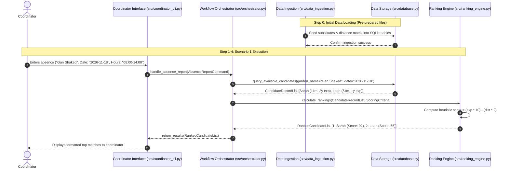
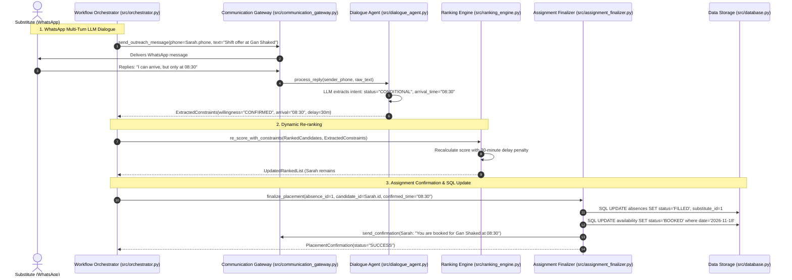

# System Architecture & Module Decomposition

This document defines the modular code decomposition for the Kindergarten Staff Scheduling Assistant MVP, based on [`design/mvp.md`](file:///C:/Users/eliya/Documents/שנה%20ג%20סמסטר%20א/מבוא%20לבינה%20מלאכותית/ai-Kindergarten-assistant/design/mvp.md) and [`design/scenarios.md`](file:///C:/Users/eliya/Documents/שנה%20ג%20סמסטר%20א/מבוא%20לבינה%20מלאכותית/ai-Kindergarten-assistant/design/scenarios.md).

Every module is designed around the **Single Responsibility Principle (SRP)**: each has one distinct area of concern and interacts with others via clear, lightweight data structures.

---

## 1. Architecture Overview

```
+----------------------------------------------------------------------------------------------------+
|                           Coordinator Interface (src/coordinator_cli.py)                           |
+-------------------------------------------------+--------------------------------------------------+
                                                  | uses
                                                  v
+----------------------------------------------------------------------------------------------------+
|                              Workflow Orchestrator (src/orchestrator.py)                           |
+---------------------+---------------------------+------------------------+-------------------------+
|                     |                           |                        |                         |
| uses                | uses                      | uses                   | uses                    | uses
v                     v                           v                        v                         v
+-----------------+  +-----------------+  +-----------------+  +-----------------+  +------------------+
| Data Ingestion  |  |  Data Storage   |  | Ranking Engine  |  | Communication   |  | Dialogue Agent   |
| (src/           |  |  (src/          |  | (src/           |  | Gateway         |  | (src/            |
|  data_          |  |   database.py)  |  |   ranking_      |  | (src/           |  |   dialogue_      |
|  ingestion.py)  |  |                 |  |   engine.py)    |  |   communication_|  |   agent.py)      |
+--------+--------+  +---+-------------+  +-----------------+  |   gateway.py)   |  +--------+---------+
         |               ^                             ^       +--------+--------+           |
         | populates     | queries / SQL UPDATE        | re-scores      ^                    | extracts
         +---------------+                             |                | uses               | constraints
                         |                             +----------------+--------------------+
                         | executes SQL UPDATE                          |
                 +-------+--------+                                     | notifies
                 | Assignment     |<------------------------------------+
                 | Finalizer      |
                 | (src/          |
                 |  assignment_   |
                 |  finalizer.py) |
                 +----------------+
```

### Module Dependency Summary
- **Coordinator Interface** calls **Workflow Orchestrator**.
- **Workflow Orchestrator** drives the pipeline across all domain modules.
- **Data Ingestion** loads pre-prepared datasets into **Data Storage**.
- **Data Storage** provides persistent relational storage (SQLite) queried and updated by the Orchestrator, Ranking Engine, and Assignment Finalizer.
- **Ranking Engine** provides pure heuristic scoring logic for candidates.
- **Communication Gateway** bridges messaging between external WhatsApp channels and the system.
- **Dialogue Agent** uses an LLM to process candidate messages and extract structured constraints.
- **Assignment Finalizer** closes confirmed assignments via atomic database updates and confirmation alerts.

---

## 2. Module Breakdown

### 2.1 Data Ingestion Module
- **Module Name & Path**: `Data Ingestion` (`src/data_ingestion.py`)
- **Single Responsibility**: Ingestion and validation of pre-prepared assistant profiles and kindergarten distance data from static files into persistent storage.
- **Usage Status**: **[ACTIVE - Scenario 1]**
- **Conceptual Inputs & Outputs**:
  - *Inputs*:
    - `RawProfilesFile`: `{ path: str, format: "csv" | "json" }`
    - `RawDistancesFile`: `{ path: str, format: "csv" | "json" }`
  - *Outputs*:
    - `IngestionResult`: `{ substitutes_loaded: int, distance_records_loaded: int, status: "SUCCESS" | "ERROR" }`

---

### 2.2 Data Storage & Repository Module
- **Module Name & Path**: `Data Storage` (`src/database.py`)
- **Single Responsibility**: Database connection management, schema initialization, and execution of SQL queries and updates.
- **Usage Status**: **[ACTIVE - Scenario 1]**
- **Conceptual Inputs & Outputs**:
  - *Inputs*:
    - `GardenCandidateQuery`: `{ garden_name: str, target_date: str }`
    - `AssignmentUpdateCommand`: `{ absence_id: int, substitute_id: int, status: str, confirmed_time: str }`
  - *Outputs*:
    - `CandidateRecordList`: `list[{ id: int, name: str, experience_years: int, distance_km: float, phone: str }]`
    - `DatabaseOperationResult`: `{ rows_affected: int, success: bool }`

---

### 2.3 Heuristic Ranking Engine
- **Module Name & Path**: `Heuristic Ranking Engine` (`src/ranking_engine.py`)
- **Single Responsibility**: Calculating heuristic suitability scores for candidates based on proximity, experience, requirements, and dynamic constraints.
- **Usage Status**: **[ACTIVE - Scenario 1]**
- **Conceptual Inputs & Outputs**:
  - *Inputs*:
    - `CandidatesToScore`: `list[{ id: int, name: str, experience_years: int, distance_km: float }]`
    - `ScoringCriteria`: `{ garden_name: str, required_hours: str, weight_experience: float, weight_distance: float, constraints_penalty: float }`
  - *Outputs*:
    - `RankedCandidateList`: `list[{ id: int, name: str, score: float, rank: int, breakdown: { exp_score: float, dist_penalty: float } }]`

---

### 2.4 Coordinator Interface Module
- **Module Name & Path**: `Coordinator Interface` (`src/coordinator_cli.py`)
- **Single Responsibility**: User-facing interaction for the kindergarten coordinator: capturing absence inputs, rendering ranked recommendations, and displaying status reports.
- **Usage Status**: **[ACTIVE - Scenario 1]**
- **Conceptual Inputs & Outputs**:
  - *Inputs*:
    - User input from coordinator: `{ garden_name: str, date: str, hours: str, notes: str }`
    - `RankedCandidateList` (for display)
    - `AssignmentSummary` (for display)
  - *Outputs*:
    - `AbsenceReportCommand`: `{ garden_name: str, date: str, hours: str, notes: str }`
    - Formatted terminal/UI display for the coordinator.

---

### 2.5 Workflow Orchestrator Module
- **Module Name & Path**: `Workflow Orchestrator` (`src/orchestrator.py`)
- **Single Responsibility**: Coordinating business workflows and dispatching data between domain modules throughout the absence lifecycle.
- **Usage Status**: **[ACTIVE - Scenario 1]**
- **Conceptual Inputs & Outputs**:
  - *Inputs*:
    - `AbsenceReportCommand`: from Coordinator Interface
    - Candidate and scoring data from Data Storage and Ranking Engine
    - Dialogue and confirmation events from Dialogue Agent and Assignment Finalizer
  - *Outputs*:
    - Direct calls to Data Storage, Ranking Engine, Communication Gateway, and Assignment Finalizer
    - `WorkflowStatusResponse`: `{ absence_id: int, state: str, top_candidates: list, confirmed_substitute: dict | None }`

---

### 2.6 Communication Gateway Module
- **Module Name & Path**: `Communication Gateway` (`src/communication_gateway.py`)
- **Single Responsibility**: Sending outbound WhatsApp messages to substitutes and receiving incoming replies via webhook or mock interface.
- **Usage Status**: **[FUTURE - Scenario 2+]**
- **Conceptual Inputs & Outputs**:
  - *Inputs*:
    - `OutboundMessage`: `{ recipient_phone: str, message_text: str, message_type: "OUTREACH" | "CONFIRMATION" }`
    - Inbound WhatsApp webhook payload: `{ sender_phone: str, raw_text: str, timestamp: str }`
  - *Outputs*:
    - `InboundReplyEvent`: `{ sender_phone: str, message_text: str, timestamp: str }`
    - `DeliveryStatus`: `{ message_id: str, delivered: bool }`

---

### 2.7 Conversational Dialogue Agent Module
- **Module Name & Path**: `Conversational Dialogue Agent` (`src/dialogue_agent.py`)
- **Single Responsibility**: Managing multi-turn LLM conversations with substitutes to confirm willingness and extract arrival constraints.
- **Usage Status**: **[FUTURE - Scenario 2+]**
- **Conceptual Inputs & Outputs**:
  - *Inputs*:
    - `DialogueContext`: `{ candidate_name: str, garden_name: str, shift_date: str, shift_hours: str, chat_history: list[{ sender: str, text: str }] }`
    - `CandidateReply`: `{ text: str }`
  - *Outputs*:
    - `AgentResponse`: `{ next_message_text: str, is_terminal: bool }`
    - `ExtractedConstraints`: `{ willingness: "CONFIRMED" | "DECLINED" | "CONDITIONAL", arrival_time: str | None, notes: str }`

---

### 2.8 Assignment Finalizer Module
- **Module Name & Path**: `Assignment Finalizer` (`src/assignment_finalizer.py`)
- **Single Responsibility**: Executing the final placement, triggering the SQL update to lock the schedule, and issuing confirmation alerts.
- **Usage Status**: **[FUTURE - Scenario 2+]**
- **Conceptual Inputs & Outputs**:
  - *Inputs*:
    - `PlacementRequest`: `{ absence_id: int, candidate_id: int, confirmed_hours: str, final_score: float }`
  - *Outputs*:
    - `PlacementConfirmation`: `{ absence_id: int, candidate_id: int, status: "FILLED", finalized_at: str }`
    - Triggers confirmation notifications to coordinator and candidate.

---

## 3. Scenario 1 Summary Table

Scenario 1 covers: **"Filter and rank available substitutes for an absence"** (loading pre-prepared profiles, filtering by kindergarten, and calculating heuristic rankings).

| Module Name | Proposed File Path | Specific Role in Scenario 1 |
| :--- | :--- | :--- |
| **Data Ingestion** | `src/data_ingestion.py` | Loads pre-prepared substitute profiles and distance records into SQLite. |
| **Data Storage** | `src/database.py` | Executes SQL queries to retrieve candidate profiles and distances for the specified kindergarten. |
| **Heuristic Ranking Engine** | `src/ranking_engine.py` | Computes heuristic scores based on proximity and experience, returning a sorted candidate list. |
| **Coordinator Interface** | `src/coordinator_cli.py` | Accepts absence parameters (garden, date, hours) from the user and displays top ranked matches. |
| **Workflow Orchestrator** | `src/orchestrator.py` | Directs the flow between Interface, Storage, and Ranking Engine for Scenario 1. |

*(Modules `src/communication_gateway.py`, `src/dialogue_agent.py`, and `src/assignment_finalizer.py` are **not** invoked in Scenario 1).*

---

## 4. Step-by-Step Information Flow

### 4.1 Scenario 1 Flow: Filter and Rank Available Substitutes

The following sequence traces how information moves between the active modules during Scenario 1:



#### Detailed Step Descriptions:
1. **Initial Profile Loading**: `Data Ingestion` parses the pre-prepared files and populates the SQLite tables (`substitutes` and `substitute_distances`).
2. **Absence Reporting**: The coordinator provides the absence details (`garden_name="Gan Shaked"`, `date="2026-11-18"`, `hours="08:00-14:00"`). `Coordinator Interface` validates the input and creates an `AbsenceReportCommand`.
3. **Candidate Fetching**: `Workflow Orchestrator` sends `GardenCandidateQuery` to `Data Storage`. The database executes a SQL `JOIN` between `substitutes` and `substitute_distances` filtering by `garden_name = 'Gan Shaked'`, returning candidate records.
4. **Heuristic Ranking**: `Workflow Orchestrator` passes the candidates to `Heuristic Ranking Engine`. The engine applies the heuristic formula:
   $$\text{Score} = (\text{experience\_years} \times 10) - (\text{distance\_km} \times 2)$$
   Sorting produces:
   - **Sarah**: $(3 \times 10) - (1.0 \times 2) \rightarrow 92$ (normalized)
   - **Leah**: $(1 \times 10) - (5.0 \times 2) \rightarrow 65$ (normalized)
5. **Presentation**: `Workflow Orchestrator` delivers the `RankedCandidateList` to `Coordinator Interface`, which displays the ranked list to the user.

---

### 4.2 Extension to Full MVP Flow (Future Scenarios)

Once Scenario 1 completes, the full MVP lifecycle seamlessly extends the flow through the remaining modules:



#### Detailed Full MVP Extension Steps:
1. **WhatsApp Outreach**: `Workflow Orchestrator` takes the top-ranked candidate from Scenario 1 (Sarah) and asks `Communication Gateway` to send an availability inquiry via WhatsApp.
2. **Multi-Turn LLM Dialogue**: When Sarah replies with natural language (e.g., *"I can arrive, but only at 08:30"*), `Communication Gateway` passes the message to `Dialogue Agent`. The agent prompts an LLM with the shift context to extract structured constraints (`willingness="CONFIRMED"`, `arrival_time="08:30"`).
3. **Dynamic Re-ranking**: `Workflow Orchestrator` passes the extracted constraints back to `Heuristic Ranking Engine`. The engine adjusts the score based on the 30-minute delay. If Sarah's adjusted score remains the highest, she remains the top match; if she had declined, the orchestrator would initiate outreach to candidate #2 (Leah).
4. **Assignment Confirmation & SQL Update**: `Workflow Orchestrator` instructs `Assignment Finalizer` to close the placement. The finalizer runs SQL `UPDATE` queries in `Data Storage` to lock the placement (`status = 'FILLED'`) and mark Sarah as unavailable for other shifts on that date, then dispatches confirmation messages to both coordinator and substitute.
